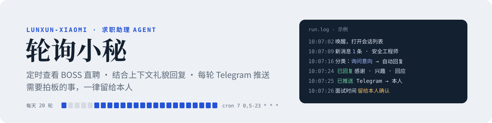

<p align="center">
  
</p>

<p align="center">
  <a href="https://claude.com/claude-code"></a>
  
  
  
  
  
  
</p>

<p align="center">
  <b>替求职者值班的小 Agent。</b>定时查看 BOSS 直聘新消息，读完整段对话再礼貌回复 HR；<br>
  每一轮都通过 Telegram 推送给本人，面试时间这类需要拍板的事，一律留给本人决定。
</p>

<p align="center">
  <a href="http://39.105.66.226/hr/">在线介绍页</a> ·
  <a href="#框架">框架</a> ·
  <a href="#技术栈">技术栈</a> ·
  <a href="#快速开始">快速开始</a> ·
  <a href="prompt/boss-reply-monitor.md">完整提示词</a>
</p>

---

## 为什么做它

海投之后，HR 的回复散落在一天里的不同时间。人在日本、有时差、还要做研究，很难每条都第一时间看到。回慢了，机会就凉了；完全交给自动化，又怕说错话、替自己做了不该做的决定。

轮询小秘的分工很简单：**Agent 负责快，人负责决定。**

## 一轮轮询

| | 步骤 | 做什么 |
|:-:|---|---|
| 01 | 定时唤醒 | cron `7 0,5-23 * * *`（日本时间），一天 20 轮，覆盖北京时间 4 点到 23 点 |
| 02 | 读取会话 | 在独立浏览器标签里打开聊天列表，找出对方发来、还没处理过的消息 |
| 03 | 理解上下文 | 通读整段对话：HR 说了什么，之前发过哪些自我介绍和简历 |
| 04 | 分类决策 | 规则闸门判断：自动回复 / 交给本人 / 忽略 |
| 05 | 回复并推送 | 先推送 Telegram，再按「感谢 → 兴趣 → 认同 → 必要信息 → 致谢」回复 |
| 06 | 记录去重 | 写日志、刷新 HTML 看板，同一条消息不回两次 |

## 框架

<p align="center">
  
</p>

## 技术栈

| 层 | 技术 | 用途 |
|---|---|---|
| 调度 | **Claude Code Scheduled Tasks**（cron） | 每天 20 轮定时启动 Agent，本地运行 |
| 推理 | **Claude**（LLM Agent） | 读对话、判断消息类型、起草回复，全部规则写在一份提示词里 |
| 执行 | **Claude in Chrome**（MCP 浏览器工具） | 在已登录的 Chrome 里读会话、输入、点击「发送 / 发简历 / 同意」 |
| 页面操作 | **JavaScript**（DOM 选择器 + `execCommand`） | 稳定地抓取聊天列表、写入输入框 |
| 推送 | **Telegram Bot API** + **Bash / curl** | 每轮汇总、单条消息即时推送；支持代理，处理了 Windows 下中文编码 |
| 状态 | **JSON** | 去重键、会话状态、回复记录 |
| 看板 | **Python 3** → **HTML / CSS / SVG** | 由 `boss_status.json` 生成可筛选的状态看板，支持深色模式 |
| 介绍页 | **HTML / CSS / SVG** + **nginx** | 给 HR 看的说明页，只用系统字体，国内访问无外部依赖 |

## 回复规则

| HR 的消息 | 处理 | |
|---|---|:-:|
| 想聊一聊、询问意向 | 感谢，表达对岗位的兴趣，回应对方的话 | 🔵 自动 |
| 索要简历或联系方式 | 发送附件简历或联系方式，并致谢 | 🔵 自动 |
| 毕业时间、到岗时间等 profile 里有的信息 | 如实回答 | 🔵 自动 |
| 面试邀约、具体时间 | 先表达参加意愿，时间由本人确认 | 🟢 本人 |
| profile 里没有的问题 | 告诉对方稍后回复，同时推送给本人 | 🟢 本人 |
| 与求职无关的推广 | 只记录 | ⚪ 忽略 |

## 设计原则

- **快，但不越权**：Agent 只负责第一时间回应，面试时间、线下安排、薪资细节交给本人。
- **不编造**：回复只使用 `profile.md` 里本人确认过的事实，答不了的如实说明。
- **读完再说**：每次回复前通读整段对话，不重复已经发过的内容。
- **先推送，后声明**：Telegram 推送确实成功后，回复里才会写「已推送给本人」。
- **不撤回、不重试**：发送失败就停下并推送，交给本人处理。
- **可追溯**：每条消息的分类和回复原文都有记录。

## 目录结构

```
lunxun-xiaomi/
├── prompt/
│   └── boss-reply-monitor.md      Agent 提示词（定时任务的 SKILL.md 模板）
├── profile.example.md             本人资料模板 → 复制为 profile.md
├── notify/
│   ├── notify_telegram.sh         Telegram 推送脚本
│   └── telegram.env.example       Bot Token / Chat ID 模板
├── dashboard/
│   ├── boss_dashboard.py          生成 HTML 状态看板
│   └── boss_status.example.json   示例数据
└── docs/
    ├── intro-page.html            给 HR 看的介绍页模板
    └── assets/                    README 用的横幅与架构图
```

## 快速开始

**1. 准备环境**：安装 Claude Code 桌面版和 Claude in Chrome 扩展，在 Chrome 里登录 BOSS 直聘。

**2. 填写资料和推送配置**

```bash
cp profile.example.md profile.md
cp notify/telegram.env.example notify/telegram.env
```

```bash
bash notify/notify_telegram.sh --get-chat-id
```

```bash
bash notify/notify_telegram.sh "轮询小秘测试推送"
```

**3. 创建定时任务**：把 `prompt/boss-reply-monitor.md` 里的 `{{...}}` 占位符换成自己的内容，在 Claude Code 里新建定时任务，以它为提示词，cron 设为 `7 0,5-23 * * *`。

**4. 预览看板**（不带参数时使用示例数据）

```bash
python dashboard/boss_dashboard.py
```

## 注意

- 自动化操作第三方平台可能违反平台用户协议，请自行评估风险，控制频率，并对 Agent 发出的每条消息负责。
- 建议先关闭自动发送、只推送观察几轮，确认回复质量后再开启。
- `profile.md`、`telegram.env` 和运行时数据都已写进 `.gitignore`。

## License

[MIT](LICENSE)
