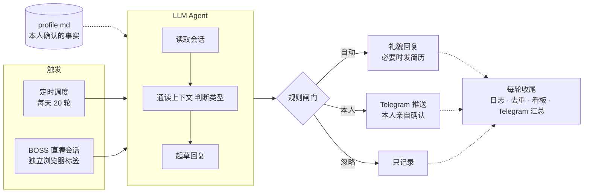

# 轮询小秘

一个替求职者「值班」的小 Agent：定时查看 BOSS 直聘的新消息，结合整段对话礼貌回复 HR，每一轮都通过 Telegram 推送给本人，需要拍板的事情一律留给本人决定。

基于 [Claude Code](https://claude.com/claude-code) 的定时任务（Scheduled Tasks）和 Claude in Chrome 浏览器扩展实现。整个 Agent 的行为由一份提示词定义，再配上几个小脚本。

在线介绍页（给 HR 看的）：http://39.105.66.226/hr/

## 它做什么

每一轮按同样的六步走：

1. **定时唤醒**：cron `7 0,5-23 * * *`（日本时间），一天 20 轮，覆盖北京时间 4 点到 23 点
2. **读取会话**：在独立的浏览器标签里打开 BOSS 聊天列表，找出对方发来、还没处理过的消息
3. **理解上下文**：通读整段对话，包括 HR 说了什么、之前发过哪些自我介绍和简历，避免重复
4. **分类决策**：按规则判断是可以直接回复、需要本人决定，还是与求职无关
5. **回复并推送**：先推送 Telegram，再按「感谢 → 兴趣 → 认同对方 → 必要信息 → 致谢」的结构回复
6. **记录去重**：写入日志，刷新 HTML 状态看板，同一条消息不会回复两次

## 框架



## 回复规则（节选）

| HR 的消息 | 处理 |
|---|---|
| 想聊一聊、询问意向 | 自动：感谢，表达对岗位的兴趣，回应对方的话 |
| 索要简历或联系方式 | 自动：发送附件简历或联系方式，并致谢 |
| 毕业时间、到岗时间等 profile 里有的信息 | 自动：如实回答 |
| 面试邀约、具体时间 | 本人：先表达参加意愿，时间由本人确认 |
| profile 里没有的问题 | 本人：告诉对方稍后回复，同时推送给本人 |
| 与求职无关的推广 | 不回复，只记录 |

完整规则见 [prompt/boss-reply-monitor.md](prompt/boss-reply-monitor.md)。

## 设计思路

- **快，但不越权**：Agent 只负责第一时间回应。面试时间、线下安排、薪资细节这类需要拍板的事都交给本人。
- **不编造**：回复只使用 `profile.md` 里本人确认过的事实，答不了的如实说明。
- **读完再说**：每次回复前通读整段对话，只针对对方这句话回应。
- **先推送，后声明**：只有 Telegram 推送确实成功了，回复里才会写「已推送给本人」。
- **每一步可追溯**：消息、分类和回复原文都有记录，方便复核。

## 目录

```
prompt/boss-reply-monitor.md     Agent 提示词（定时任务的 SKILL.md 模板）
profile.example.md               本人资料模板 → 复制为 profile.md
notify/notify_telegram.sh        Telegram 推送脚本
notify/telegram.env.example      Bot Token / Chat ID 模板 → 复制为 telegram.env
dashboard/boss_dashboard.py      由 boss_status.json 生成 HTML 状态看板
dashboard/boss_status.example.json  示例数据
docs/intro-page.html             给 HR 看的介绍页模板
```

## 使用

1. 安装 Claude Code 桌面版和 Claude in Chrome 扩展，在 Chrome 里登录 BOSS 直聘。
2. 复制 `profile.example.md` 为 `profile.md` 并填写；复制 `notify/telegram.env.example` 为 `notify/telegram.env`，填入 Bot Token 和 Chat ID（可以用 `bash notify/notify_telegram.sh --get-chat-id` 获取）。
3. 把 `prompt/boss-reply-monitor.md` 里的 `{{...}}` 占位符换成自己的内容，在 Claude Code 中新建定时任务，以它作为提示词，cron 设为 `7 0,5-23 * * *`。
4. 预览看板：`python dashboard/boss_dashboard.py`（不带参数时使用示例数据）。

## 注意

- 自动化操作第三方平台可能违反平台的用户协议，请自行评估风险，控制频率，并对 Agent 发出的每条消息负责。
- 建议先在暂停自动发送的状态下观察几轮，确认回复质量后再开启。
- `profile.md`、`telegram.env` 和运行时数据都已写入 `.gitignore`，不要把它们提交到仓库。

## License

MIT
